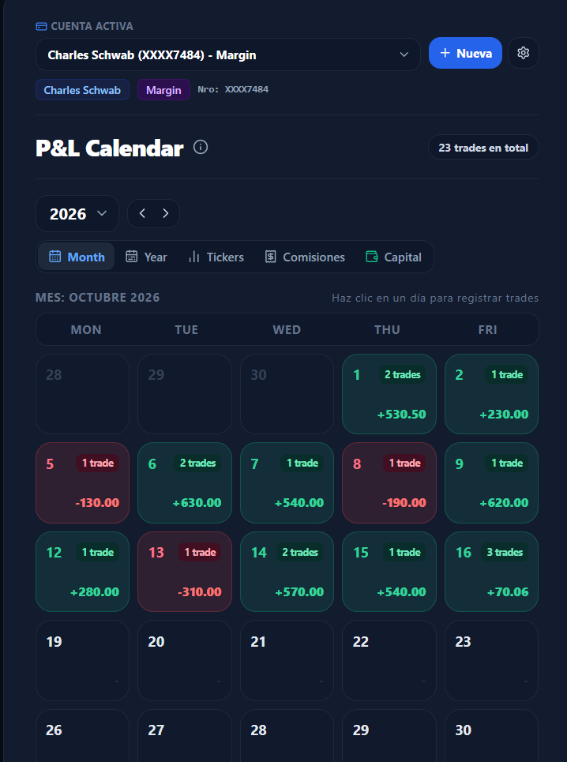
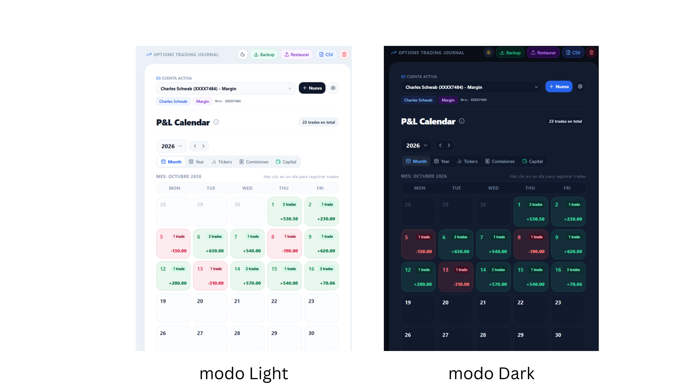
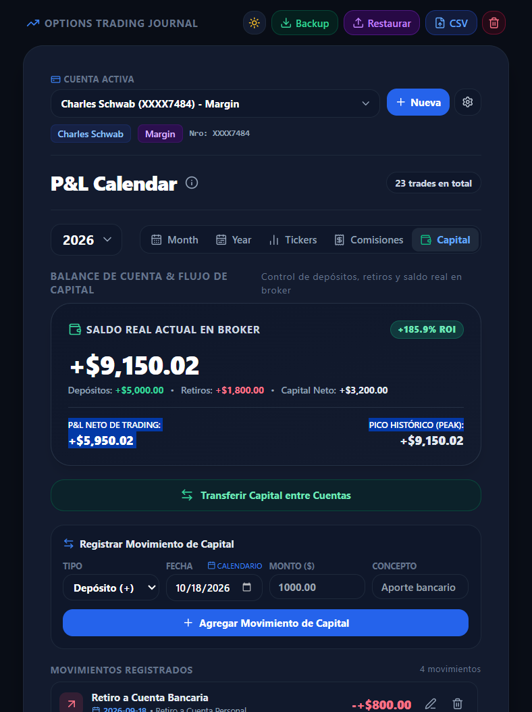
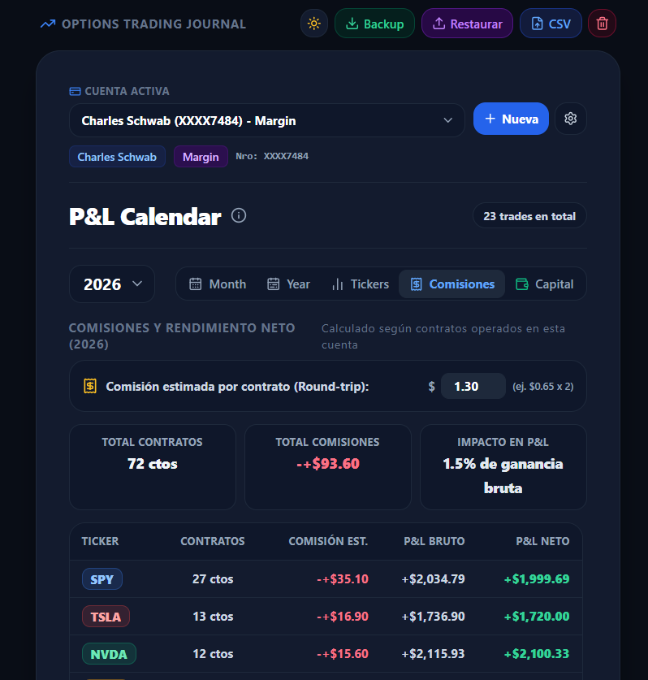
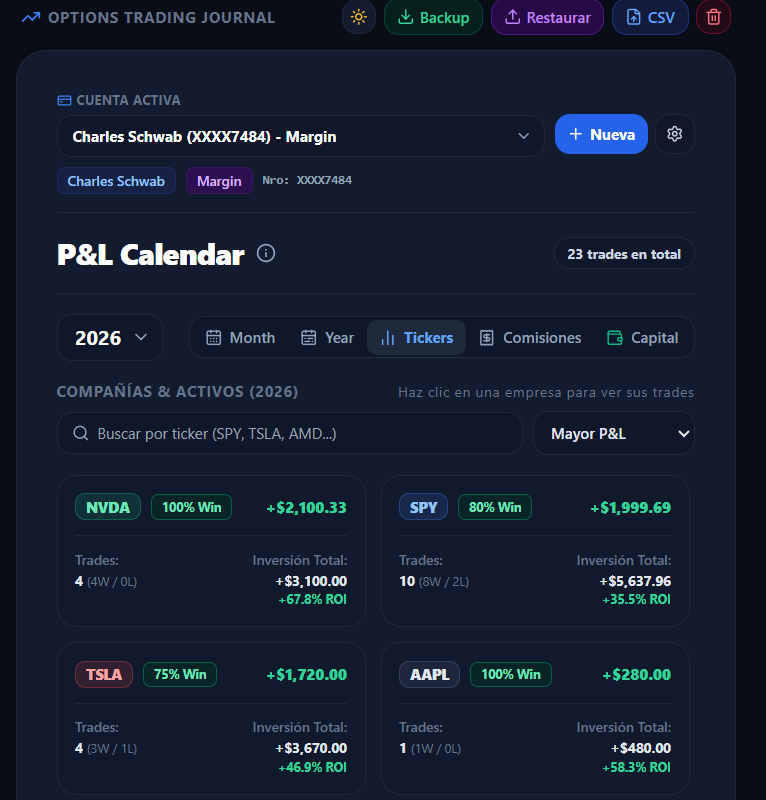
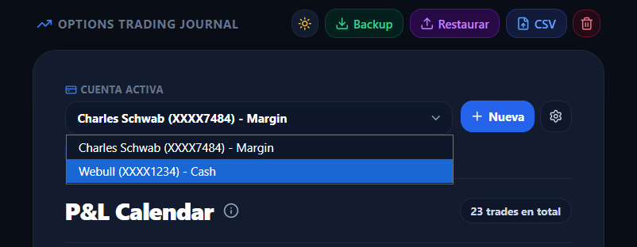
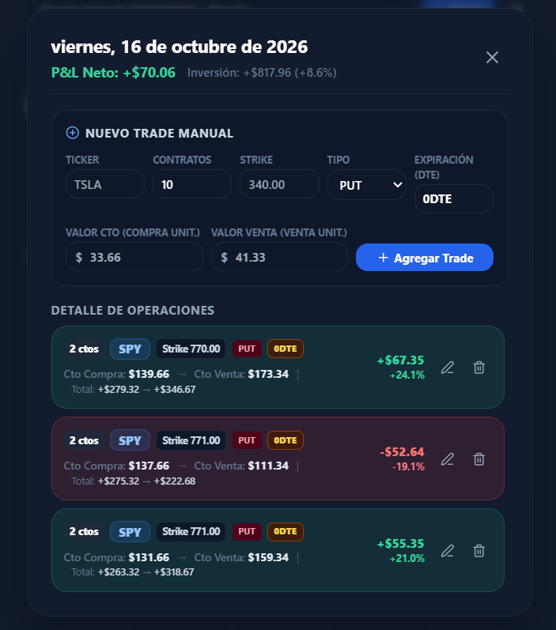

# 📈 P&L Calendar, Multicuenta & Options Trading Journal

Un diario de trading profesional, visual e interactivo para opciones financieras y acciones. Diseñado para monitorear el **P&L real**, la **curva de capital de cuenta (Equity Curve)**, **comisiones del broker**, **gestión multicuenta**, **transferencias internas** y estadísticas oficiales bajo las métricas de **Charles Schwab / Thinkorswim**.

Construido como una Single Page Application (SPA) en **HTML5, Tailwind CSS y JavaScript Vanilla**, sin dependencias de servidor: tus datos se mantienen **100% privados y seguros** en el almacenamiento local de tu navegador (`localStorage`), con opción de descarga y restauración de respaldos en formato JSON.

---

## 📸 Capturas de Pantalla & Recorrido Visual (8 Secciones)

### 1. Vista Mensual (Trading P&L Calendar)
Calendario operativo de **lunes a viernes** con colores pastel diferenciados para ganancias y pérdidas, conteo de trades cerrados por día y el identificador dinámico **Today** que resalta de forma exclusiva en el día en curso del sistema:

<p align="center">
  
</p>

---

### 2. Modo Dark & Light Integrado
Alterna en un solo clic entre una interfaz limpia en tonos claros y un **Dark Mode estilo Fintech/OLED**, diseñado para sesiones de trading prolongadas con alto contraste y fatiga visual mínima:

<p align="center">
  
</p>

---

### 3. Pestaña de Capital Real & Balance de Cuenta
Control estricto de dinero real: diferencia el rendimiento de tus trades de los movimientos bancarios. Registra depósitos y retiros con selector de fecha interactivo, edición directa de montos y cálculo del saldo real exacto en el broker:

<p align="center">
  
</p>

---

### 4. Pestaña de Comisiones & Impacto Operativo
Mide el *Fee Drag* (arrastre de comisiones): calcula el número total de contratos cerrados, el total pagado en comisiones a tu broker y la comparación entre tu ganancia bruta y la ganancia neta líquida:

<p align="center">
  
</p>

---

### 5. Resumen de Desempeño por Ticker (Compañías)
Tarjetas organizadas con **insignias cromáticas personalizadas** (`SPY`, `TSLA`, `NVDA`, `AMD`, `QQQ`, etc.), porcentaje de acierto (**Win Rate %**), volumen de contratos, capital invertido y desglose de trades ganadores vs perdedores:

<p align="center">
  
</p>

---

### 6. Soporte Multicuenta & Transferencias entre Brokers
Administra múltiples portafolios de forma independiente (ej. *Charles Schwab Margin*, *Webull Cash*, *Interactive Brokers*). Si tienes 2 o más cuentas registradas, se habilita la opción de transferir saldo entre ellas con un clic:

<p align="center">
  
</p>

---

### 7. Detalle Diario: Registro y Modificación de Trades
Ventana modal completa para registrar o **modificar** operaciones existentes. Permite desglosar número de contratos (`Qty`), `Strike` numérico limpio, tipo (`CALL/PUT`), expiración calculada (`0DTE`, `1DTE`, etc.), costo unitario de compra, precio de venta y retorno porcentual (`ROI %`):

<p align="center">
  
</p>

---

### 8. Respaldo Completo y Restauración (JSON)
Exporta con un solo clic una copia de seguridad íntegra de todas tus cuentas, operaciones, movimientos de capital y ajustes en formato `.json`, permitiendo restaurarla de inmediato en cualquier dispositivo:

<p align="center">
  
</p>

---

## 🚀 Características y Funcionalidades Detalladas

### 🏦 Arquitectura Multicuenta Aislada
- **Múltiples Brokers:** Registra cuentas separadas especificando Broker, Identificador/Número de cuenta (ej. `XXXX7484`) y Tipo de cuenta (`Margin`, `Cash`, `IRA / Retiro`, `Fondeo`).
- **Aislamiento Total de Datos:** Las operaciones, el saldo de capital, las comisiones y los archivos CSV se procesan de forma exclusiva para la cuenta activa sin mezclar números.
- **Transferencias entre Cuentas:** Si posees dos o más cuentas registradas, se habilita el botón **«Transferir Capital entre Cuentas»** en la pestaña *Capital*, registrando automáticamente un retiro en la cuenta de origen y un depósito en la de destino con la misma fecha.

### 💰 Control de Capital Real & Flujos Bancarios
- **Diferenciación entre P&L y Capital:** El crecimiento real de tu portafolio no depende solo de ganar trades, sino de controlar cuánto capital arriesgas, cuánto depositas y cuánto retiras.
- **Fórmula de Balance en Vivo:**
  ```text
  Saldo Real de Cuenta = (Total Depósitos - Total Retiros) + P&L Neto Acumulado